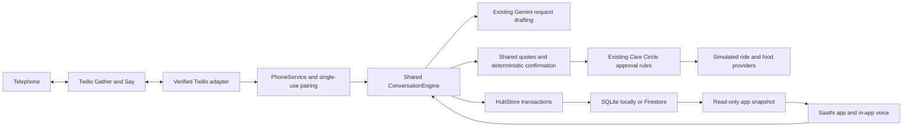

# Saathi telephone assistant

## Scope and status

Actual Twilio Programmable Voice webhook code is implemented. There is **no phone simulator UI or simulator endpoint**. Tests post signed callbacks locally; that does not prove a live call. No telephone number, cloud resource, paid API or deployment was created for this work.

One existing FastAPI service hosts app APIs and public, signature-verified voice webhooks. React/Vite and anonymous HMAC-signed browser sessions remain unchanged. No Google login or ADK installation is introduced.

## Modules

- [Conversation engine](../../backend/app/conversation.py): app request handling and multi-turn workflow. Gemini proposes typed drafts; the engine recognises confirmation itself.
- [Shared workflows](../../backend/app/workflows.py): preferences, food filtering, prices, appointments, history and audit.
- [Bookings](../../backend/app/bookings.py): quoted totals, connection checks, approvals, idempotent provider execution and separate payment status.
- [Phone service](../../backend/app/phone.py): durable call lifecycle and pairing. The provider supplies a verified call identifier, never an account ID.
- [Telephony adapter](../../backend/app/telephony.py): official Twilio SDK signatures and TwiML. A protocol separates provider rendering/authentication from conversations.
- [Storage](../../backend/app/hub_store.py): transactional multi-document operations. External AI requests never run inside a transaction.

## Data

| Namespace | Contents |
| --- | --- |
| `hubAccounts/{owner}` | Existing profile, bookings, conversations, audit, call references and revocation epoch |
| `phonePairings/{HMAC verifier}` | Owner, expiry, consumed flag and transcript preference; no raw code |
| `phoneSessions/{HMAC call ID}` | Lifecycle, conversation state, pending action and bounded callback responses |
| `phoneEvents/{session}_{event}` | Structured redacted events: channel, time, workflow state and request reference |
| `phoneLimits/{scope}` | Shared admission and pairing limits |

Firestore client rules remain deny-all. Backend IAM is required. Transactions prevent races across workers; booking and pairing correctness do not depend on in-memory locks.

## Adaptations

- App management uses `/api/hub/phone/*` because the existing cookie is scoped to `/api/hub`. Twilio routes use `/api/phone/twilio/*` without browser cookies.
- App chat preserves its request/quote contract; both channels use the shared engine/workflows, not separate orchestration.
- Phone always requests explicit confirmation. The app's automatic-booking preference is not used on calls.
- One request per call. Completion, cancellation, failure or external approval ends the call. Redial and pair again for another request.
- WhatsApp is a future channel, not a connected transport. Phone medicine ordering is excluded.
- Read-only `/api/hub/snapshot` polling runs every three seconds on Activity/detail/Profile/conversation screens, eight seconds elsewhere. Hidden/offline tabs pause polling; requests do not overlap.

See [setup](telephony-setup.md), [security](pairing-and-security.md) and [verification](testing.md).